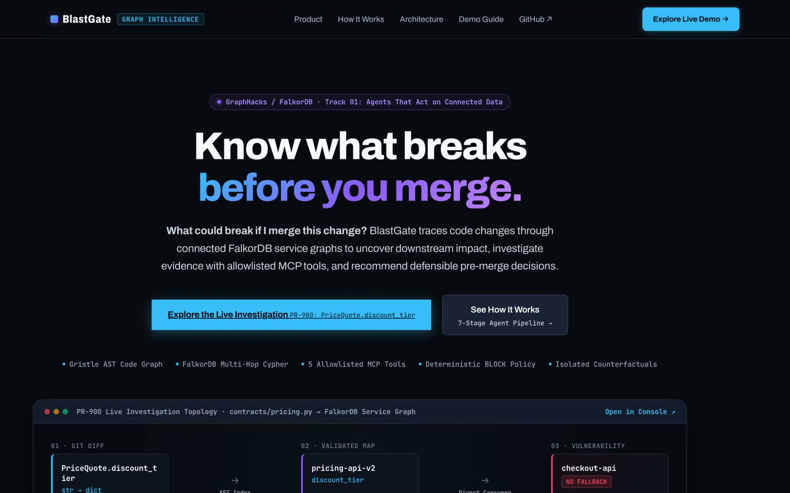
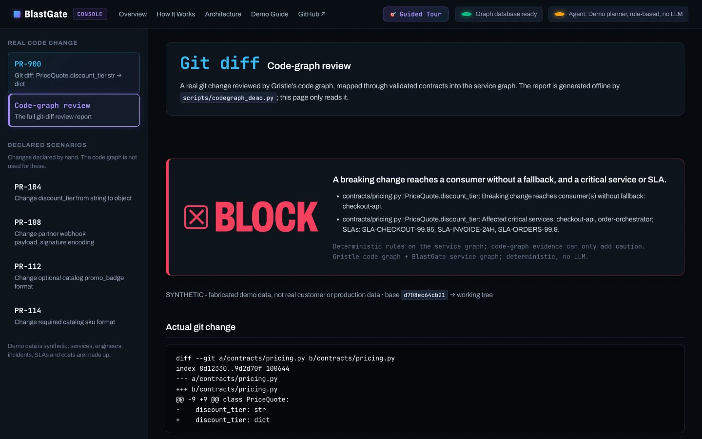
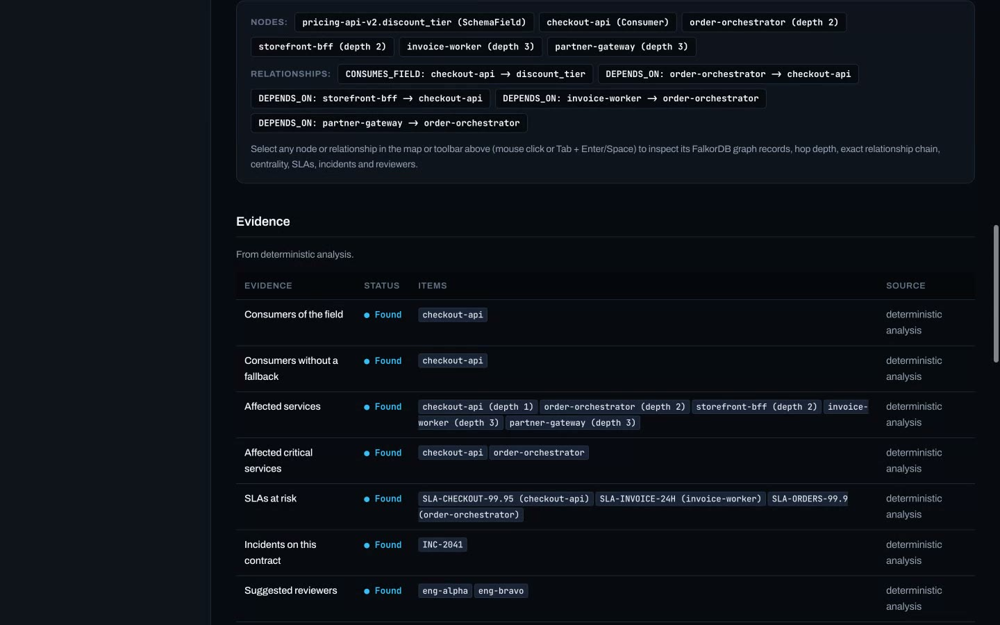
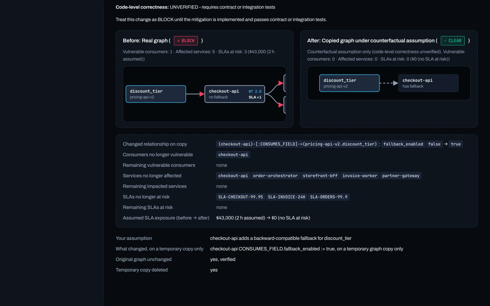
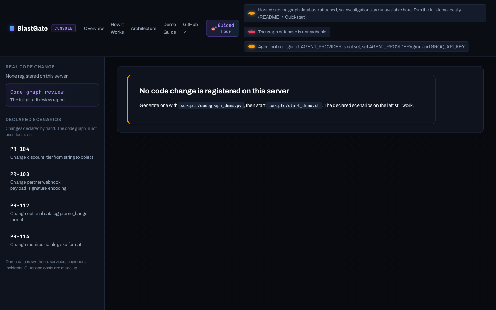
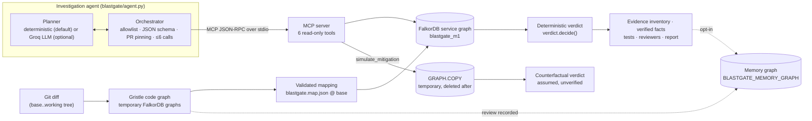

<div align="center">

# BlastGate

### Know what breaks before you merge.

BlastGate follows a code change through a code graph and a FalkorDB service graph so you can see which downstream services, SLAs and incidents it reaches, then gives a deterministic, evidence-backed **BLOCK / WARN / CLEAR** decision.

**GraphHacks 2026 · FalkorDB · Track 01: Agents That Act on Connected Data**

[Live website](https://blastgate.vercel.app) ·
[GitHub](https://github.com/ThatKJ/blastgate-graphhacks-2026) ·
[Judge quickstart](#judge-quickstart-local-about-5-minutes) ·
[Architecture](#architecture) ·
[Track 01 mapping](#track-01-requirement-mapping) ·
[Limitations](#trust-security-and-limitations)

</div>

> [!IMPORTANT]
> **The investigation itself runs locally. The public site is the product website.**
> <https://blastgate.vercel.app> serves the product website, the docs pages and the console UI from the real FastAPI app.
> No FalkorDB instance is attached to that deployment, so its console says *"Hosted site: no graph database attached"*,
> and `/ready` returns `503 graph_unavailable`. Run the full graph-backed investigation (PR-900, MCP tools, verdict
> and counterfactual) with the [local quickstart](#judge-quickstart-local-about-5-minutes).

> [!NOTE]
> **All demo data is synthetic.** Services, engineers (`eng-alpha`, …), incidents (`INC-2041`, …), SLAs and penalty
> rates are made up. They describe no real company, person, customer or measured loss.



---

## The problem

Imagine changing one field: `PriceQuote.discount_tier` goes from `str` to `dict`. The diff is two lines, and the
changed file looks fine. The risk sits in the files you *didn't* open:

- a consumer (`checkout-api`) reads that field and **has no fallback**;
- three services depend on that consumer, and they back **SLAs** with penalty clauses;
- this contract caused an incident before (`INC-2041`), and the engineers who resolved it are the right reviewers.

None of that lives in the changed file. It lives in **relationships**: code → contract → consumer → dependency
chain → SLA → incident → engineer. Reviewing only the diff misses the blast radius.

## The solution

```text
Git diff → Gristle code graph → validated mapping → FalkorDB service graph → MCP investigation
        → deterministic verdict → recommendations → isolated counterfactual
```

1. **Code graph.** [Gristle](https://github.com/Alchemy-Agentic/gristle) indexes the base and head commits into two
   temporary FalkorDB code graphs. BlastGate's Cypher finds the changed symbols and the type-level users, callers,
   routes and tests.
2. **Validated mapping.** `blastgate.map.json`, read from the **base commit**, maps the source class to a service
   contract field. A mapping is accepted only if the service exists and `EXPOSES` that contract and field. BlastGate
   never guesses from names.
3. **Service-graph investigation.** An agent calls **6 allowlisted, typed MCP tools** backed by FalkorDB queries.
   Every tool result returns `next_actions` that point to the next hop in the graph.
4. **Deterministic verdict.** `verdict.decide()` turns the graph evidence into BLOCK / WARN / CLEAR. The planner
   (rule-based or LLM) **can't change it**.
5. **Recommendations.** Tests come from `TESTS_FUNCTION` edges, and reviewers from `RESOLVED_INCIDENT` /
   `AUTHORED_COMMITS` edges.
6. **Counterfactual.** BlastGate assumes a mitigation, applies it on a `GRAPH.COPY` and re-runs the rules there.
   The original graph and verdict are never touched.

**This is more than a graph visualization next to a chatbot.** The graph decides what the agent looks at next:
consumers lead to the blast radius, which leads to criticality, then incidents and reviewers. The graph also
supplies every fact in the answer: model text that cites something no tool returned is withheld. And the graph
decides the outcome through deterministic rules over traversed evidence.

## Demo links

| What | Where | Status |
| --- | --- | --- |
| Product website + docs | <https://blastgate.vercel.app> (`/`, `/how-it-works`, `/architecture`, `/demo-guide`) | ✅ Live on Vercel (verified 2026-10-18) |
| Console UI (hosted) | <https://blastgate.vercel.app/console> | ⚠️ Loads; investigations unavailable because no graph DB is attached |
| Full interactive demo | Local: `scripts/start_demo.sh` → `http://127.0.0.1:8766/console` | ✅ Verified end to end (PR-900 → BLOCK → counterfactual CLEAR) |
| Source | <https://github.com/ThatKJ/blastgate-graphhacks-2026> | Public |
| Demo video | Uploaded with the submission (raw screen recording of the local demo) | — |

## Judge quickstart (local, about 5 minutes)

**Prerequisites:** Docker, Python 3.12 (3.11+ works for Gristle, 3.10+ for BlastGate itself), git. No LLM key
is needed.

```bash
git clone https://github.com/ThatKJ/blastgate-graphhacks-2026.git && cd blastgate-graphhacks-2026

# 1. FalkorDB (the image digest these tests ran on: graph module 4.22.1)
docker run -d --name blastgate-falkordb -p 6379:6379 falkordb/falkordb@sha256:b0bdcac2cbaff989e77cb0610439b7a9289e86de033ccbbd4368b66fb680ae7a

# 2. BlastGate environment and the synthetic service graph "blastgate_m1"
python3.12 -m venv .venv && .venv/bin/pip install -r requirements.txt
.venv/bin/python blastgate_milestone1.py

# 3. Gristle in its own venv (it pins mcp<2), then the real git-diff review
scripts/setup_gristle.sh
export BLASTGATE_GRISTLE_BIN="$PWD/.gristle-venv/bin/gristle"
export BLASTGATE_MEMORY_GRAPH=blastgate_memory
.venv/bin/python scripts/codegraph_demo.py      # exit code 2 = BLOCK; writes codegraph_demo_out/report.{md,json}

# 4. Console + API on one origin, deterministic planner, PR-900 registered
scripts/start_demo.sh                           # prints http://127.0.0.1:8766/  (PORT=8770 scripts/start_demo.sh to change)
```

`start_demo.sh` checks that FalkorDB is up, that the graph is seeded and that the report exists. It refuses a port
that's already in use and never stops another process.

**Then, in the console:**

1. **Change.** Open **PR-900**. It shows the real diff `contracts/pricing.py::PriceQuote.discount_tier: str → dict`.
   **Code-graph review** opens the full Gristle report: 6 functions and 2 routes linked to `PriceQuote`, and the
   validated mapping to `pricing-api-v2.discount_tier`.
2. **Graph.** **Analyze impact**. The traversal reaches `checkout-api` (no fallback), then 4 downstream services
   and 3 synthetic SLAs.
3. **Investigation.** **Investigate with agent**. The timeline lists every MCP call: tool, arguments, why it ran,
   result and graph evidence. The badge reads *Demo planner, rule-based, no LLM*.
4. **Decision.** **BLOCK**, with reasons, the evidence inventory, `INC-2041`, reviewers `eng-alpha` and
   `eng-bravo`, and the recommended tests.
5. **Counterfactual.** **Run simulation**. The copy with the assumed fallback reads **CLEAR**, next to the real
   graph, which still reads **BLOCK**. The result is labelled *assumed, unverified*.

## Screenshots

All of these are frames from a real recording of the local console (PR-900) and the deployed site.

| Code-graph review → BLOCK | Graph evidence |
| --- | --- |
|  |  |

| Counterfactual on an isolated copy | Hosted console (Vercel, no DB attached) |
| --- | --- |
|  |  |

## Architecture



| Component | File |
| --- | --- |
| FastAPI app, website and console routes | `blastgate/api.py`, `web/` |
| Service-graph seed and data | `blastgate/graph.py` |
| Service-graph Cypher | `blastgate/queries.py` |
| Analysis steps and exposure | `blastgate/analysis.py` |
| Verdict rules | `blastgate/verdict.py` |
| MCP server and tool implementations | `blastgate/mcp_server.py`, `blastgate/tools.py` |
| Planners, orchestrator, explanation gate | `blastgate/agent.py` |
| Counterfactual on `GRAPH.COPY` | `blastgate/simulation.py` |
| Gristle review (git diff → code graph → verdict) | `blastgate/codegraph.py`, `scripts/codegraph_demo.py` |
| Investigation memory | `blastgate/memory.py` |
| Vercel entrypoint | `app.py`, `vercel.json` |

## Technical deep dive

### Service graph schema

```text
(:Service {name, tier: critical|standard, team, synthetic})
(:Contract {contract_id, kind, consumer_mapping_status: complete|incomplete, coverage_note, synthetic})
(:SchemaField {name, contract_id, field_type, required})
(:SLAContract {sla_id, name, penalty_per_hour_usd, synthetic: true, label})
(:Incident {incident_id, severity, summary, synthetic: true, label})
(:Engineer {handle, display_name, synthetic: true})

(Service)-[:EXPOSES]->(Contract)-[:HAS_FIELD]->(SchemaField)
(Service)-[:CONSUMES_FIELD {fallback_enabled, evidence_source}]->(SchemaField)
(Service)-[:DEPENDS_ON]->(Service)            # (B)-[:DEPENDS_ON]->(A): B depends on A
(Service)-[:BACKS_SLA]->(SLAContract)
(Incident)-[:CAUSED_BY_CHANGE_IN]->(Contract)
(Engineer)-[:AUTHORED_COMMITS]->(Service)
(Engineer)-[:RESOLVED_INCIDENT]->(Incident)
```

```text
pricing-engine → checkout-api → order-orchestrator → invoice-worker
                      └→ storefront-bff        └→ partner-gateway
catalog-service → search-indexer, storefront-bff
```

`seed()` loads the constants in `blastgate/graph.py` with parameterised `UNWIND` queries and checks every node and
relationship count against the source data. If a count is off, it deletes the graph. This matters because
`UNWIND … MATCH … CREATE` silently skips unmatched rows, and one dropped consumer edge would quietly turn BLOCK into
CLEAR.

### Representative Cypher (from [`blastgate/queries.py`](blastgate/queries.py))

```cypher
// Consumers of the changed field, anchored at the producer so same-named contracts can't leak in
MATCH (:Service {name: $producer})-[:EXPOSES]->(:Contract {contract_id: $contract})
      -[:HAS_FIELD]->(f:SchemaField {name: $field})<-[r:CONSUMES_FIELD]-(s:Service)
...

// Multi-hop blast radius from the consumers
MATCH p = (d:Service)-[:DEPENDS_ON*1..8]->(v:Service)
WHERE v.name IN $consumers
RETURN d.name, d.tier, length(p), [n IN nodes(p) | n.name]

// Network criticality (sampled, pinned seed for reproducibility; informational only)
CALL algo.betweenness({nodeLabels: ['Service'], relationshipTypes: ['DEPENDS_ON'],
                       samplingSize: $size, samplingSeed: $seed})
YIELD node, score
```

On the code graph (Gristle's schema), [`blastgate/codegraph.py`](blastgate/codegraph.py) runs `CG_SYMBOLS_IN_FILE`
(diff hunks → `Function`/`Class`), `CG_TYPE_FIELDS` (base vs head `TypeField`s), `CG_TYPE_USERS`
(`ACCEPTS|RETURNS`), `CG_CALLERS` (`CALLS*1..4`, confidence = weakest `resolution`), `CG_ROUTES`
(`Route-[:HANDLES]`) and `CG_TESTS` (`TESTS_FUNCTION`). All of these are parameterised `ro_query` calls.

> **Type-level ≠ field-level.** `ACCEPTS`/`RETURNS` links show that a function handles `PriceQuote`, not that it
> reads `discount_tier`. The report labels these links as type-level. Unmapped code (`reporting/`) stays **unknown**.
> Code evidence can only *add* caution (CLEAR → WARN), never remove it.

### MCP tools (`python -m blastgate.mcp_server`, stdio, official `mcp` 2.3.0 SDK)

Every tool returns `{status, summary, data, evidence[], unknowns[], next_actions[], error_code}`.

| Tool | Input (validated) | Output |
| --- | --- | --- |
| `inspect_change` | `pr_id` (enum of known PRs) | producer, contract, field, old type from the graph vs declared new type, breaking flag |
| `inspect_contract_coverage` | `pr_id` | mapping status; every consumer with `fallback_enabled` and `evidence_source` |
| `trace_blast_radius` | `pr_id`, `max_depth` 1–8 | affected services with depth and path, synthetic SLAs, labelled exposure estimate |
| `analyze_network_criticality` | `services` (1–20 ids, `^[a-z][a-z0-9-]*$`) | `algo.betweenness` scores (sampled, informational) |
| `retrieve_incidents_and_reviewers` | `pr_id`, `services` | incidents caused by changes to *this* contract; engineers linked by graph edges |
| `simulate_mitigation` | `pr_id`, `consumer`, `assumption` (10–300 chars) | before/after on a `GRAPH.COPY`; source integrity checked; fails closed |

**Safety boundaries:**
- There's no raw-Cypher tool, and no tool accepts a graph name.
- Ids are re-validated at the tool boundary.
- The orchestrator enforces a static allowlist, JSON-schema validation, pinning to the PR under investigation, no
  duplicate calls and a hard cap of 6 calls.
- `simulate_mitigation` runs only when the user asks for it, and only with the user's own arguments.
- The only write goes to a temporary copy, which is deleted in `finally`.

### Planner vs policy

| | Deterministic planner (default, demoed) | Groq planner (optional) |
| --- | --- | --- |
| Chooses tools by | following each tool result's `next_actions` | the LLM (`tool_choice="auto"`) over MCP-discovered schemas |
| LLM involved | **No** | Yes (`AGENT_PROVIDER=groq`, `GROQ_API_KEY`) |
| Shown in UI as | *Demo planner, rule-based, no LLM* | *Agent: live model …* |
| Verified in this repo | ✅ every recorded run | Covered by tests with **scripted** Groq responses; a live run was **not** part of this verification |

In both modes the verdict comes from `analysis.analyze()` → `verdict.decide()`. If the model's recommended verdict
disagrees, the response shows that as a warning; the model's verdict is never used.

### Verdict rules ([`blastgate/verdict.py`](blastgate/verdict.py))

1. Producer, contract or field not found → **WARN**.
2. Breaking change, plus a consumer with `fallback_enabled=false`, plus an affected critical service or SLA →
   **BLOCK**. The same without a critical service or SLA → **WARN**.
3. Mapping not `complete`, or a consumer with unevidenced fallback data → **WARN**.
4. Otherwise → **CLEAR**. An empty consumer list means "nobody we know of", so CLEAR requires complete coverage.

### Evidence inventory and explanation gate

Each evidence category (vulnerable consumers, affected and critical services, SLAs, incidents, reviewers) gets a
status: `found`, `none_found`, `unknown`, `not_checked` or `check_failed`. Only `none_found` supports a claim
that something is absent. `summary` and `verified_facts` are built by code from tool payloads.

Model text is withheld (`explanation_status: withheld_inconsistent`) if it:
- denies something whose status isn't `none_found`; or
- names an incident, SLA, engineer or service that no tool returned.

This gate exists because of a real live run: the model said "no incidents" right after its own tool call
returned one.

### Counterfactual isolation

`simulate_mitigation`:
1. copies the service graph with `GRAPH.COPY`;
2. sets `fallback_enabled=true` on one `CONSUMES_FIELD` edge in the copy;
3. re-runs the same rules on the copy;
4. checks that the source graph is unchanged, and deletes the copy.

If containment can't be verified, the result is discarded (`error_code: integrity`). Every result carries
`mitigation_status: "assumed_unverified"` and `code_level_correctness: UNVERIFIED`. The PR-900 verdict stays
**BLOCK**.

### Investigation memory (opt-in, `BLASTGATE_MEMORY_GRAPH`)

Memory lives in a **separate** FalkorDB graph, so the service graph is never written. The code-graph reviewer and
the investigation agent run as separate processes, and both write to it and read from it:

```text
(:Investigation)-[:EXAMINED]->(:Change)-[:MODIFIES]->(:ContractField)
(:Investigation)-[:FOUND_AFFECTED]->(:Service)   (:Investigation)-[:FOUND_AT_RISK]->(:SLA)
(:Investigation)-[:CITED]->(:Incident)           (:Investigation)-[:RECOMMENDED_REVIEWER]->(:Engineer)
(:Investigation)-[:FOLLOWS]->(:Investigation)    (:Investigation)-[:BUILDS_ON]->(:CodeReview)
```

- **Recall:** by exact contract-field key, up to 5 earlier investigations and 5 code reviews.
- **History is context, not evidence:** each remembered fact is re-checked against the current graph, and the
  verdict is computed without memory.
- **Safe writes:** each record is one atomic `MERGE`, so a retry creates nothing new.
- **Failures don't change results:** a memory failure is reported as `recall_failed` / `record_failed`, and the
  investigation result stands.

### Error handling

Errors use the shape `{"error", "message"}`:

| Status | Code | When |
| --- | --- | --- |
| 404 | `unknown_scenario` | unknown PR id |
| 422 | — | malformed request body |
| 503 | `graph_unavailable` | FalkorDB unreachable |
| 503 | `agent_provider_not_configured` | no agent provider set |
| 503 | `tool_server_unavailable` | MCP server can't start |
| 429 | `provider_rate_limited` | provider limit hit (sent with `Retry-After`) |
| 502 / 504 | `provider_*` | provider auth, model, request, network or timeout failure |

A failed agent run is never returned as a completed investigation. A demo result is never substituted.

### HTTP API

| Route | Purpose |
| --- | --- |
| `GET /health` | always 200; reports `falkordb: up/down`, provider status, code-graph report availability; never returns secrets |
| `GET /ready` | 200 only when FalkorDB is reachable, else 503 |
| `GET /api/scenarios` | synthetic PRs (plus PR-900 when a code-graph report is configured) |
| `POST /api/analyze` | deterministic analysis and verdict (no LLM) |
| `POST /api/simulate` | counterfactual on a temporary graph copy |
| `POST /api/agent/investigate` | agent over MCP: inventory, verified facts, gated explanation, tool trace, memory |
| `GET /api/codegraph/report` | serves the one pre-generated review file; takes no caller input, runs no subprocess |

## Track 01 requirement mapping

| Requirement | Source | What a judge sees |
| --- | --- | --- |
| **Multi-hop reasoning** | `queries.py` (`CONSUMES_FIELD` → `DEPENDS_ON*1..8` → `BACKS_SLA`, `CAUSED_BY_CHANGE_IN` → `RESOLVED_INCIDENT`); `codegraph.py` (`ACCEPTS/RETURNS` → `CALLS*1..4` → `HANDLES` / `TESTS_FUNCTION`) | Impact map `pricing-engine → checkout-api → order-orchestrator → invoice-worker`; depth per service |
| **Graph queries/algorithms as tools** | `tools.py`, `mcp_server.py`, `algo.betweenness`, `GRAPH.COPY` | Agent timeline: each call's graph evidence ids |
| **MCP tool selection** | `agent.py` `DeterministicPlanner` (follows `next_actions`) and `GroqPlanner` (LLM-chosen) | Timeline shows tool, arguments and *why it ran*; planner badge. **Demo runs use the deterministic planner; live LLM selection is test-covered with scripted responses, not demonstrated live.** |
| **Actions based on graph data** | `verdict.py`, recommended tests (`TESTS_FUNCTION`), reviewers (graph edges), review report, counterfactual | BLOCK decision, reasons, tests, reviewers, `codegraph_demo_out/report.md` |
| **Explainable results** | `agent.py` inventory + explanation gate; `verified_facts` from tool payloads | Evidence panel with five statuses; unresolved items; counterfactual labelled *assumed, unverified* |

## Trust, security and limitations

- **Synthetic data.** Every service, engineer, incident, SLA and penalty rate is made up.
- **The `$43,000` is an assumption, not a loss.** It equals the synthetic penalty rates of the affected SLAs
  (`$21,500/h`) × the scenario's **assumed** 2-hour outage. The API labels it *"ASSUMED exposure … Not a measured
  or predicted loss."*
- **Type-level links don't prove field reads.** Unmapped or ambiguous contracts stay `unknown` and are never
  guessed.
- **The policy decides.** The deterministic engine owns the verdict, and no planner or model can override it.
- **The offline planner isn't an LLM.** Its tool order follows the returned `next_actions`.
- **A counterfactual is hypothetical.** CLEAR on the copy says what the topology would imply *if* the fix existed;
  it doesn't show that real code handles the new type.
- **No GitHub merge blocking is wired up.** `python -m blastgate.codegraph` exits `2` on BLOCK, so a CI job *could*
  gate on it, but this repo ships no GitHub Action or status check. Merge blocking is a recommendation.
- **Deployment.** The Vercel deployment has no FalkorDB, no agent provider and no code-graph report. Gristle and
  the MCP stdio subprocess aren't exercised there. The graph-backed demo is local-only, and the hosted console
  says so.
- **Live provider safety.** `/api/agent/investigate` in Groq mode accepts only loopback callers unless
  `AGENT_LIVE_TOKEN` is set, and it applies in-process rate limits. `GROQ_API_KEY` never leaves the server, and
  there's no CORS middleware.
- **Not production-ready.**
  - The demo routes are unauthenticated.
  - The rate-limit counters are per-process.
  - Betweenness is a sampled approximation.
  - The code graph covers Python and TypeScript only.

## Development and tests

Results as rerun on 2026-10-18 (macOS, Python 3.12 venv, FalkorDB in Docker, Node 26):

```bash
.venv/bin/python -m pytest -q -rs
# 218 passed, 11 skipped
#   10 skipped: tests/integration/test_codegraph_live.py (BLASTGATE_GRISTLE_BIN not set)
#    1 skipped: tests/providers/test_groq_live.py      (GROQ_API_KEY not set; live Groq not tested)

BLASTGATE_GRISTLE_BIN="$PWD/.gristle-venv/bin/gristle" .venv/bin/python -m pytest -q tests/integration/test_codegraph_live.py
# 10 passed (real Gristle indexing + FalkorDB)

node --test web/tests/view.test.mjs
# 25 passed (console rendering of recorded real backend responses)
```

FalkorDB-backed tests skip with a stated reason when the database is unreachable. A skipped test is not a passed
test.

| Suite | Proves | Needs |
| --- | --- | --- |
| `tests/unit` | verdict rules, simulation, diff parsing, mapping, memory rules | nothing |
| `tests/agent` | Groq request shape and errors (scripted), orchestrator guards, full agent over real MCP | FalkorDB for live parts |
| `tests/mcp` | real stdio server: discovery, schemas, results, DB-down, graph isolation | FalkorDB |
| `tests/api` | routes, validation, errors, CSP and static serving, code-graph report endpoint | partly FalkorDB |
| `tests/integration` | seed integrity, code-graph live scenarios, PR-900 agent loop, memory across processes | FalkorDB (+ Gristle) |
| `tests/evaluation` | 12 synthetic agent tasks with machine-checked expectations | FalkorDB |
| `tests/providers` | opt-in live Groq smoke test | `GROQ_API_KEY` |

**Optional live LLM.** Put `AGENT_PROVIDER=groq` and `GROQ_API_KEY=…` in a local, git-ignored `.env`
(see `.env.example`). Load it with `set -a; source .env; set +a`, then run `uvicorn blastgate.api:app --port 8000`.

**Deploying the site.** Run `npx vercel deploy --prod`. `app.py` exposes `blastgate.api:app`, `vercel.json` selects
FastAPI, and `.vercelignore` keeps `.env`, the venvs and the generated output out of the upload. To make the hosted
console fully interactive, you would need to:
1. point `FALKORDB_HOST` / `FALKORDB_PORT` / `FALKORDB_PASSWORD` at a reachable FalkorDB instance, set as Vercel
   environment variables (never in tracked files);
2. seed that instance with the service graph;
3. supply a code-graph report.

None of this is configured on the current deployment.

| Symptom | Fix |
| --- | --- |
| `503 graph_unavailable` | `docker start blastgate-falkordb` |
| `Port … is already in use` from `start_demo.sh` | `PORT=8770 scripts/start_demo.sh` |
| `No code-graph review yet` | run step 3 of the quickstart (`scripts/codegraph_demo.py`) |
| `Service graph 'blastgate_m1' not found` | `.venv/bin/python blastgate_milestone1.py` |
| `503 agent_provider_not_configured` | expected without `AGENT_PROVIDER`; `start_demo.sh` sets `deterministic` |
| Console says *"older server"* | restart it with `scripts/start_demo.sh` |

## AI-assisted development disclosure

This project was built with AI coding assistance, disclosed per the GraphHacks rules:

- **Claude Code** (Anthropic) wrote and ran the code, tests, deployment and this README, under human direction.
- **Everything Claude Code (ECC)** workflows were used for:
  - doc-checked research (`search-first`) on FalkorDB, `GRAPH.COPY`, `algo.betweenness`, the `mcp` 2.x SDK and
    the `groq` SDK;
  - an adversarial correctness audit (`change-impact`), which found and fixed a silent-CLEAR seeding bug and a
    cross-producer contract leak.
- **Ponytail** was used for minimal-code discipline.
- **Runtime:** GroqCloud is the optional live LLM provider. The demo uses the deterministic planner.

The team reviewed the code and can explain the graph model, the queries, the agent loop and the decisions.

---

<div align="center">

**BlastGate doesn't just display connected data. It uses graph relationships to investigate a change, guide its
next steps and explain its engineering decision.**

[Website](https://blastgate.vercel.app) · [Repository](https://github.com/ThatKJ/blastgate-graphhacks-2026) · [Run it locally](#judge-quickstart-local-about-5-minutes)

</div>
