# BlastGate
## Know what breaks before you merge.

BlastGate is a graph-powered engineering investigation agent. It traces code changes through connected code and
service graphs, investigates downstream impact with FalkorDB-backed MCP tools, and produces explainable pre-merge
engineering decisions.

**GraphHacks 2026 (FalkorDB) · Track 01: Agents That Act on Connected Data**

| | |
| --- | --- |
| Product website | <https://blastgate.vercel.app> (website, docs and console UI; no graph database attached, [see below](#what-runs-where)) |
| Public repository | <https://github.com/ThatKJ/blastgate-graphhacks-2026> |
| Interactive demo | [Run it locally in about 5 minutes](#quickstart-from-a-fresh-clone): FalkorDB in Docker, no LLM key needed |
| Demo video | *Link to be added once uploaded* |


---

## Problem and solution

A small API or schema change can break consumers and downstream services that the changed file never mentions.
A reviewer looking at the diff sees two lines. The risk is in the relationships: which service reads the field,
whether it has a fallback, what depends on that service, which SLAs those services back, and which earlier
incidents this contract caused.

BlastGate follows those relationships and gathers the evidence they lead to. It then decides whether to
**BLOCK**, **WARN** (investigate further) or **CLEAR** the change.

**The graph is central.** It isn't a picture next to a chatbot:
- **The graph supplies every fact.** Consumers, hop depths, SLAs, incidents and reviewers all come from Cypher
  over FalkorDB.
- **The graph steers the investigation.** Each tool result names the next tool to call (`next_actions`), based
  on what the graph returned.
- **The graph decides the verdict.** Deterministic rules run over the traversed evidence.
- **Without FalkorDB nothing works.** `/api/analyze`, the agent and the simulation return `503 graph_unavailable`
  and produce no verdict at all.

## Walkthrough: the flagship scenario

> **Synthetic demonstration.** The services, engineers (`eng-alpha`, …), incidents (`INC-2041`), SLA penalty rates
> and the dollar exposure are made up. They describe no real company, person, customer or measured loss.

A developer changes `PriceQuote.discount_tier: str → dict` in `examples/shop_monorepo/contracts/pricing.py`.
BlastGate registers the change as **PR-900**.

1. **Detect the git change.** `git diff -U0` against the base commit finds the changed hunk. The changed symbol is
   whichever `Class` node's line range overlaps that hunk.
2. **Index with Gristle.** [Gristle](https://github.com/Alchemy-Agentic/gristle) indexes the base and the working
   tree into two temporary FalkorDB code graphs. Comparing `TypeField`s across the two shows that `discount_tier`
   changed type. A type change is breaking.
3. **Validate the contract mapping.** `blastgate.map.json`, read from the **base** commit, maps
   `contracts/pricing.py::PriceQuote` to `pricing-engine / pricing-api-v2 / discount_tier`. The service graph has to
   confirm that producer, contract and field, or the mapping is `invalid` and the impact stays unknown.
4. **Query the service graph.** `checkout-api` consumes the field **without a fallback**.
   `DEPENDS_ON*1..8` then reaches `order-orchestrator` and `storefront-bff` (depth 2), and `invoice-worker` and
   `partner-gateway` (depth 3). Three synthetic SLAs are at risk.
5. **Investigate through MCP tools.** The agent calls 5 of the 6 allowlisted tools over MCP (stdio):
   `inspect_change` → `inspect_contract_coverage` → `trace_blast_radius` → `analyze_network_criticality` →
   `retrieve_incidents_and_reviewers`. Each call is chosen from the previous result's `next_actions`.
6. **Apply the deterministic policy.** A breaking change reaches a consumer with no fallback, and the impact
   includes a critical service and SLAs, so the verdict is **BLOCK**.
7. **Explain and recommend.**
   - The reasons come from the policy.
   - The evidence inventory gives each category a status.
   - The recommendations are drawn from graph edges:
     - incident `INC-2041` (`CAUSED_BY_CHANGE_IN`);
     - reviewers `eng-alpha` and `eng-bravo` (`RESOLVED_INCIDENT` / `AUTHORED_COMMITS`);
     - tests linked by `TESTS_FUNCTION`.
   - Assumed exposure: **$43,000**, computed as $21,500/h of synthetic SLA penalties × an assumed 2-hour outage.
8. **Counterfactual (optional).** *Assume `checkout-api` adds a fallback.* That assumption is applied on a
   `GRAPH.COPY`, where the verdict becomes **CLEAR**. On the real graph it stays **BLOCK**. The copy's result is
   labelled *assumed, unverified*.

| Graph evidence for PR-900 | Counterfactual: real BLOCK vs copy CLEAR |
| --- | --- |
|  |  |

## What runs where

| Surface | Where | What it does |
| --- | --- | --- |
| **Product website + docs** | <https://blastgate.vercel.app>: `/`, `/how-it-works`, `/architecture`, `/demo-guide` | Live. Served by the real FastAPI app on Vercel |
| **Hosted console** | <https://blastgate.vercel.app/console> | The UI loads, but **no FalkorDB is attached**: `/ready` returns `503 graph_unavailable`, `/health` reports `falkordb: down`, `/api/codegraph/report` returns 404, and a banner says investigations are unavailable. **No investigation runs here.** |
| **Graph-backed demo** | Your machine: [quickstart](#quickstart-from-a-fresh-clone) → `http://127.0.0.1:8766/console` | The full flow: PR-900, Gristle report, MCP agent, BLOCK, counterfactual, memory. Deterministic planner, no LLM key |
| **Optional live LLM planner** | Local, with `AGENT_PROVIDER=groq` + `GROQ_API_KEY` | Groq chooses the tool calls; the verdict is still deterministic. Tested only with scripted responses; **a real Groq run is not part of this verification** |
| **Not available** | — | Hosted investigations, GitHub merge blocking / status checks, real (non-synthetic) data ingestion |

Making the hosted console interactive would take three things, none of which exist today:
1. a reachable FalkorDB instance, configured through `FALKORDB_HOST` / `FALKORDB_PORT` / `FALKORDB_PASSWORD` as
   Vercel environment variables;
2. that instance seeded with the service graph;
3. a pre-generated code-graph report.

## Architecture

```mermaid
flowchart LR
  diff["Git diff<br/>base commit vs working tree"] --> gristle["Gristle code graphs<br/>(temporary, in FalkorDB)"]
  gristle --> map["Validated mapping<br/>blastgate.map.json @ base"]
  map --> svc[("FalkorDB service graph<br/>blastgate_m1")]

  subgraph agent["Agent: blastgate/agent.py"]
    planner["Planner: picks tools<br/>deterministic (default) or Groq (optional)"]
    orch["Orchestrator: allowlist, JSON schema,<br/>PR pinning, no duplicates, max 6 calls"]
    planner <--> orch
  end

  orch -- "MCP over stdio" --> mcp["MCP server<br/>blastgate/mcp_server.py<br/>6 typed tools"]
  mcp -- "parameterised ro_query" --> svc
  svc --> policy["Deterministic policy: decides verdict<br/>blastgate/verdict.py"]
  policy --> out["BLOCK / WARN / CLEAR<br/>reasons, evidence inventory,<br/>tests, reviewers"]
  mcp -- "simulate_mitigation (on request)" --> copy[("GRAPH.COPY<br/>deleted afterwards")]
  copy --> cf["Counterfactual verdict<br/>assumed, unverified"]
  out -. "opt-in" .-> mem[("Memory graph<br/>BLASTGATE_MEMORY_GRAPH")]
  map -. "code review recorded" .-> mem
  mem -. "recalled as context,<br/>revalidated" .-> agent
```



**The planner picks the tools.** The deterministic planner follows each result's `next_actions`; the optional
Groq planner lets the model choose among the MCP-discovered schemas. The orchestrator can reject any proposed
call.

**The policy decides the verdict.** After the tool loop, `analysis.analyze()` → `verdict.decide()` runs over the
service graph. No planner output or memory feeds into it.

| Component | Source |
| --- | --- |
| FastAPI app, website and console routes | [`blastgate/api.py`](blastgate/api.py), [`web/`](web/) |
| Service graph seed data and loader | [`blastgate/graph.py`](blastgate/graph.py) |
| Service-graph Cypher | [`blastgate/queries.py`](blastgate/queries.py) |
| Analysis steps and exposure | [`blastgate/analysis.py`](blastgate/analysis.py) |
| Verdict policy | [`blastgate/verdict.py`](blastgate/verdict.py) |
| MCP server / tool implementations | [`blastgate/mcp_server.py`](blastgate/mcp_server.py), [`blastgate/tools.py`](blastgate/tools.py) |
| Planners, orchestrator, inventory, explanation gate | [`blastgate/agent.py`](blastgate/agent.py) |
| Counterfactual | [`blastgate/simulation.py`](blastgate/simulation.py) |
| Gristle review: diff → code graph → mapping → verdict | [`blastgate/codegraph.py`](blastgate/codegraph.py), [`scripts/codegraph_demo.py`](scripts/codegraph_demo.py) |
| Investigation memory | [`blastgate/memory.py`](blastgate/memory.py) |
| Vercel entrypoint | [`app.py`](app.py), [`vercel.json`](vercel.json) |

## Graph data model

### Service graph (`blastgate_m1`, seeded by [`blastgate/graph.py`](blastgate/graph.py))

| Node | Key properties | Purpose |
| --- | --- | --- |
| `Service` | `name`, `tier` (`critical`/`standard`), `team` | producers, consumers and downstream services |
| `Contract` | `contract_id`, `kind`, `consumer_mapping_status` (`complete`/`incomplete`), `coverage_note` | API a producer exposes; is consumer coverage known to be complete? |
| `SchemaField` | `name`, `contract_id`, `field_type`, `required` | the changed field |
| `SLAContract` | `sla_id`, `name`, `penalty_per_hour_usd` | business commitment at risk |
| `Incident` | `incident_id`, `severity`, `summary` | history of this contract breaking things |
| `Engineer` | `handle`, `display_name` | reviewer candidates |

| Relationship | Direction | Purpose |
| --- | --- | --- |
| `EXPOSES` | `Service → Contract` | anchors every query at the verified producer |
| `HAS_FIELD` | `Contract → SchemaField` | contract structure |
| `CONSUMES_FIELD {fallback_enabled, evidence_source}` | `Service → SchemaField` | who reads the field and whether they tolerate the change |
| `DEPENDS_ON` | `Service → Service` (B depends on A) | multi-hop blast radius |
| `BACKS_SLA` | `Service → SLAContract` | SLA exposure (never counted as a hop) |
| `CAUSED_BY_CHANGE_IN` | `Incident → Contract` | prior incidents from changing this contract |
| `RESOLVED_INCIDENT` | `Engineer → Incident` | reviewers with incident context |
| `AUTHORED_COMMITS` | `Engineer → Service` | reviewers who know the affected services |

Every node carries `synthetic: true` (or a label to that effect). `seed()` checks each node and relationship count
against the source constants and deletes the graph on any mismatch. This matters because `UNWIND … MATCH … CREATE`
silently skips unmatched rows, so a dropped `CONSUMES_FIELD` edge would otherwise turn BLOCK into CLEAR without
any error.

### Code graph (Gristle schema, two temporary graphs per review)

`Function` and `Class` nodes (`qualified_name`, `file_path`, `start_line`, `end_line`, `is_test`), plus
`TypeField` (`name`, `type_annotation`) and `Route`. Edges: `Class-[:HAS_FIELD]->TypeField`,
`Function-[:ACCEPTS|RETURNS]->Class`, `Function-[:CALLS {resolution}]->Function`, `Route-[:HANDLES]->Function`
and `-[:TESTS_FUNCTION {depth}]->Function`. BlastGate deletes both graphs after each review.

### The mapping between them: `blastgate.map.json`

See [`examples/shop_monorepo/blastgate.map.json`](examples/shop_monorepo/blastgate.map.json):

```json
{ "services":  [{"service": "checkout-api", "paths": ["checkout_api/"]}, ...],
  "contracts": [{"symbol": "contracts/pricing.py::PriceQuote", "producer": "pricing-engine",
                 "contract_id": "pricing-api-v2", "fields": {"discount_tier": "discount_tier", ...}}] }
```

- **Read from the base commit,** so a PR can't rewrite its own mapping. It's parsed with a strict pydantic model,
  and a symbol mapped twice is rejected.
- **Paths map to a service** with one of four outcomes: `mapped`, `unmapped` (no path matches), `ambiguous` (more
  than one service matches) or `invalid` (the service isn't in the service graph).
- **A contract mapping is `validated` only** if the service graph confirms the producer, the contract it
  `EXPOSES` and the field. Anything else stays unknown and becomes an uncertainty with a WARN, never a guess.
  BlastGate never matches names or field strings.
- **Code dependents are cross-checked** against `CONSUMES_FIELD`, and each one is reported as `corroborated`,
  `code_only` or `service_graph_only`.

> **Type-level, not field-level.** `ACCEPTS`/`RETURNS` shows that a function handles `PriceQuote`. It does
> **not** show that the function reads `discount_tier`. The report labels these links as type-level. Code
> evidence can only add caution (CLEAR → WARN); it never relaxes a verdict and never creates a BLOCK on its own.

### Memory graph (opt-in, `BLASTGATE_MEMORY_GRAPH`, separate from the service graph)

`Investigation`, `Change`, `ContractField {key}`, `CodeReview`, plus memory copies of `Service`, `SLA`,
`Incident` and `Engineer` keyed by exact ids. Edges: `EXAMINED`, `MODIFIES`, `FOUND_AFFECTED {depth, tier}`,
`FOUND_AT_RISK`, `CITED`, `RECOMMENDED_REVIEWER`, `FOLLOWS`, `BUILDS_ON`, `DETECTED_CHANGE_TO` and
`CODE_DEPENDENT_IN`. See [Memory](#persistent-memory-across-runs).

## Cypher queries and graph algorithms

All of these are real queries from the source. They're parameterised and run with `ro_query`, except
`SET_FALLBACK`, which only ever runs on a copy.

### Service graph ([`blastgate/queries.py`](blastgate/queries.py), used by [`analysis.py`](blastgate/analysis.py) and [`tools.py`](blastgate/tools.py))

| Query | Question it answers | Effect on the investigation / verdict |
| --- | --- | --- |
| `COVERAGE` | Does this producer expose this contract and field, and is consumer mapping complete? | Producer, contract or field missing → **WARN** and `unknown` evidence. Incomplete coverage blocks CLEAR. |
| `CONSUMERS` | Who consumes the field, and do they have a fallback? | A consumer with `fallback_enabled=false` is the precondition for BLOCK. Leads to `trace_blast_radius`. |
| `DOWNSTREAM` | What transitively depends on the vulnerable consumers? | Affected services with hop depth and path. A critical service among them can trigger BLOCK. |
| `SLAS` | Which SLAs do the affected services back? | An affected SLA can trigger BLOCK. Penalty rates feed the labelled exposure estimate. |
| `CENTRALITY` | Which affected services are dependency chokepoints? | `algo.betweenness` on `DEPENDS_ON`. **Informational only, never a verdict input.** |
| `INCIDENTS` | Has changing this contract caused incidents before? | Incident evidence and the reviewers who resolved them. |
| `REVIEWERS` | Who resolved those incidents or committed to affected services? | Recommended reviewers, ranked by incidents, then services. |
| `SET_FALLBACK` | *(write, copy only)* What if this consumer had a fallback? | Used only by the counterfactual on a `GRAPH.COPY`. |

```cypher
// CONSUMERS: anchored at the producer so a same-named contract elsewhere can't leak in
MATCH (:Service {name: $producer})-[:EXPOSES]->(:Contract {contract_id: $contract})
      -[:HAS_FIELD]->(f:SchemaField {name: $field})<-[r:CONSUMES_FIELD]-(s:Service)
RETURN s.name, s.tier, r.fallback_enabled, r.evidence_source
ORDER BY s.name

// DOWNSTREAM: only DEPENDS_ON edges, so length(p) is a pure service-to-service hop count
MATCH p = (d:Service)-[:DEPENDS_ON*1..8]->(v:Service)
WHERE v.name IN $consumers
RETURN d.name, d.tier, length(p), [n IN nodes(p) | n.name]

// CENTRALITY: FalkorDB betweenness, with sampling pinned for reproducible scores
CALL algo.betweenness({nodeLabels: ['Service'], relationshipTypes: ['DEPENDS_ON'],
                       samplingSize: $size, samplingSeed: $seed})
YIELD node, score
WITH node, score WHERE node.name IN $services
RETURN node.name, score
ORDER BY score DESC, node.name

// REVIEWERS: graph-evidenced reviewers, never inferred owners
MATCH (e:Engineer)
OPTIONAL MATCH (e)-[:RESOLVED_INCIDENT]->(i:Incident)-[:CAUSED_BY_CHANGE_IN]->(:Contract {contract_id: $contract})
               <-[:EXPOSES]-(:Service {name: $producer})
WITH e, collect(DISTINCT i.incident_id) AS incidents
OPTIONAL MATCH (e)-[:AUTHORED_COMMITS]->(s:Service)
WHERE s.name IN $services
WITH e, incidents, collect(DISTINCT s.name) AS services
WHERE size(incidents) > 0 OR size(services) > 0
RETURN e.handle, e.display_name, incidents, services
ORDER BY size(incidents) DESC, size(services) DESC, e.handle
```

The `samplingSize` and `samplingSeed` are pinned (32 and 1) because the default time-based seed was observed to
score the same node 0.0 on one run and 6.0 on another.

### Code graph ([`blastgate/codegraph.py`](blastgate/codegraph.py))

| Query | Pattern | Purpose |
| --- | --- | --- |
| `CG_SYMBOLS_IN_FILE` | `(n:Function\|Class {file_path})` | Line ranges matched against diff hunks: which symbols changed |
| `CG_TYPE_FIELDS` | `(:Class)-[:HAS_FIELD]->(:TypeField)` | Base vs head comparison: removed or type-changed fields are breaking |
| `CG_TYPE_USERS` | `(:Function)-[:ACCEPTS\|RETURNS]->(:Class)` | Code that handles the contract type (type-level) |
| `CG_CALLERS` | `(:Function)-[:CALLS*1..4]->(:Function)` | Transitive callers; confidence is the weakest edge `resolution` |
| `CG_ROUTES` | `(:Route)-[:HANDLES]->(:Function)` | HTTP routes exposed to the change |
| `CG_TESTS` | `()-[:TESTS_FUNCTION]->(:Function)` | Tests to recommend |

```cypher
// CG_CALLERS
MATCH p = (caller:Function)-[:CALLS*1..4]->(fn:Function)
WHERE fn.qualified_name IN $names AND NOT caller.qualified_name IN $names
RETURN caller.qualified_name, caller.file_path, coalesce(caller.is_test, false),
       [r IN relationships(p) | r.resolution], [n IN nodes(p) | n.qualified_name]
```

### Counterfactual isolation ([`blastgate/simulation.py`](blastgate/simulation.py))

`GRAPH.COPY` the service graph → run `SET_FALLBACK` on the copy → run the same analysis and policy on the copy →
confirm the source graph is unchanged → delete the copy in `finally`. If containment can't be verified, the
result is discarded (`error_code: integrity`).

## MCP tools and agent behavior

The MCP server `python -m blastgate.mcp_server` uses the official `mcp` 2.3.0 SDK over stdio. It's started as a
subprocess for each investigation. Every tool returns
`{status, summary, data, evidence[], unknowns[], next_actions[], error_code}`.

| Tool | Inputs (validated) | Returns | Role, and its `next_actions` |
| --- | --- | --- | --- |
| `inspect_change` | `pr_id` (enum of registered PRs) | producer, contract, field, graph type vs new type, breaking | Does the target exist? → `inspect_contract_coverage` |
| `inspect_contract_coverage` | `pr_id` | mapping status, consumers with `fallback_enabled` / `evidence_source` | Who is exposed? → `trace_blast_radius` if a consumer is vulnerable |
| `trace_blast_radius` | `pr_id`, `max_depth` 1–8 | affected services with depth and path, SLAs, labelled exposure | How far does it reach? → `analyze_network_criticality`, `retrieve_incidents_and_reviewers` |
| `analyze_network_criticality` | `services` (1–20 ids, re-checked against the graph) | sampled betweenness scores | Context: which affected services are chokepoints |
| `retrieve_incidents_and_reviewers` | `pr_id`, `services` | contract incidents, graph-linked engineers | History and the right reviewers |
| `simulate_mitigation` | `pr_id`, `consumer`, `assumption` (10–300 chars) | before/after verdicts on a `GRAPH.COPY` | Counterfactual; **only when the user asks** |

**How tools get chosen.**
- `DeterministicPlanner` (the default, and what the demo uses) is **not an LLM**. It starts with `inspect_change`,
  then calls whatever the returned `next_actions` name. On any tool error it stops and never guesses around the
  failure. Its tool order follows the graph results, but it isn't autonomous model selection.
- `GroqPlanner` (optional) gives the LLM the MCP-discovered schemas with `tool_choice="auto"`. This path is
  covered only by tests with **scripted** Groq responses; a real Groq run hasn't been verified for this
  submission.

**Guards.** The orchestrator enforces all of these no matter which planner runs:
- a static allowlist (a tool must also be discovered over MCP);
- JSON-schema validation, rejecting unexpected arguments;
- `pr_id` pinned to the PR under investigation;
- no duplicate calls;
- at most **6** calls, and at most 3 rejected proposals before the run stops;
- `simulate_mitigation` runs only with the user's own consumer and assumption.

There's no raw-Cypher tool, and no tool accepts a graph name.

**What gets recorded.** The timeline records each call's tool, arguments, purpose, result summary, graph evidence
ids, timing and any rejection. The model's reasoning text is never stored. A failed run returns an error status,
never a completed investigation and never a substituted demo result.

## Decision policy, evidence and trust boundaries

**The policy is authoritative.** The rules in [`blastgate/verdict.py`](blastgate/verdict.py):
1. Producer, contract or field not found → **WARN**.
2. Breaking change, a consumer with `fallback_enabled=false`, and an affected critical service or SLA →
   **BLOCK**. The same without a critical service or SLA → **WARN**.
3. Coverage not `complete`, or a consumer with unevidenced fallback data → **WARN**.
4. Otherwise → **CLEAR**. An empty consumer list means "nobody we know of", so CLEAR requires complete coverage.

If an LLM's recommended verdict disagrees with the policy, the disagreement appears in `warnings`. The model never
sets the verdict.

**Evidence inventory.** Each category (vulnerable consumers, affected and critical services, SLAs, incidents,
reviewers) gets one of five statuses:

| Status | Meaning | Can support "there are none"? |
| --- | --- | --- |
| `found` | the graph returned items | no |
| `none_found` | checked, and nothing exists in the checked graph | **yes, and only this status** |
| `unknown` | the change target isn't verified in the graph | no |
| `not_checked` | not looked up in this investigation | no |
| `check_failed` | the lookup errored | no |

- **Code builds the facts.** `summary` and `verified_facts` are built from the verdict, the inventory and the tool
  payloads, never from model text.
- **Inconsistent model text is withheld.** Model text is set aside (`explanation_status: withheld_inconsistent`,
  with a warning) if it claims an absence whose status isn't `none_found`, or names an entity no tool returned.
  This rule came from a real live run in which the model said "no incidents" right after its own tool call
  returned one.
- **Unresolved items are listed explicitly.**

**Trust boundaries.**
- **Synthetic data.** All records are synthetic: no real customers, employees, incidents or financial losses.
- **`$43,000` is illustrative.** It's $21,500/h of synthetic SLA penalty rates × an **assumed** 2-hour outage.
  The API labels it *"ASSUMED exposure … Not a measured or predicted loss."*
- **Type links aren't field reads.** A class- or type-level code link doesn't prove that a function reads a
  specific field.
- **Unmapped means unknown.** Unmapped, ambiguous or invalid mappings stay unknown.
- **A counterfactual CLEAR is hypothetical.** It isn't evidence that real code handles the new type, and the real
  verdict doesn't change.
- **No merge blocking is integrated.** `python -m blastgate.codegraph` exits `2` on BLOCK, so a CI job could gate on
  it. But there's no GitHub Action, status check or branch-protection integration in this repo.
- **Live provider safety.** Live Groq investigations accept only loopback callers unless `AGENT_LIVE_TOKEN` is
  set, and they're rate-limited in-process. The key never leaves the server.

## Persistent memory across runs

Memory is opt-in. It needs `BLASTGATE_MEMORY_GRAPH` set; `scripts/start_demo.sh` defaults it to
`blastgate_memory`. Implemented in [`blastgate/memory.py`](blastgate/memory.py).

- **Dedicated graph.** Memory never writes to the service graph.
- **What gets saved.**
  - Each investigation saves the change, its affected services and depths, SLAs, cited incidents, recommended
    reviewers, the verdict and the planner mode.
  - Each code review (written by the same `record_code_review` function the Gristle reviewer uses) saves the
    symbol, the type change, the code-dependent services and the uncertainties.
  - Each record is one atomic Cypher `MERGE`, so a retry creates nothing new.
- **Recall.** Recall matches the exact `contract_id.field` key, returning at most 5 investigations and 5 code
  reviews. A new investigation links `FOLLOWS` to earlier ones, and `BUILDS_ON` to a code review only if recall
  actually returned that review.
- **Revalidation.** Every remembered fact is shown next to what the *current* graph says. For example: *"code graph
  found checkout-api handling PriceQuote" → "consumer in the current service graph"*. History is context, not
  evidence. The verdict is computed without memory, so a prior CLEAR never clears a new BLOCK.
- **Empty or failed memory.** Unset memory gives `memory: null`, and nothing is written. Failures are reported as
  `recall_failed` / `record_failed`, and the investigation result is unchanged.
- **Verified across processes.** [`tests/integration/test_memory_live.py`](tests/integration/test_memory_live.py)
  runs each investigation, with its real MCP subprocess, in a **separate Python process**. The second process
  recalls and revalidates the first. A code review recorded beforehand is recalled by the agent process and linked
  with `BUILDS_ON`.

## Quickstart from a fresh clone

**Prerequisites:**
- Docker;
- `python3.12`, used for both venvs (that's what was tested; BlastGate needs 3.10+, Gristle 3.11+);
- git, and `curl` for the checks below.

No Groq key is needed: the demo uses the deterministic planner.

```bash
git clone https://github.com/ThatKJ/blastgate-graphhacks-2026.git
cd blastgate-graphhacks-2026

# 1. FalkorDB (pinned digest the tests ran on: graph module 4.22.1)
docker run -d --name blastgate-falkordb -p 6379:6379 \
  falkordb/falkordb@sha256:b0bdcac2cbaff989e77cb0610439b7a9289e86de033ccbbd4368b66fb680ae7a

# 2. Main environment, then seed the synthetic service graph "blastgate_m1" (prints the scenario verdicts)
python3.12 -m venv .venv
.venv/bin/pip install -r requirements.txt
.venv/bin/python blastgate_milestone1.py

# 3. Gristle in its OWN venv (it pins mcp<2; BlastGate uses mcp 2.x). Pinned to v0.12.0, commit d72083d
scripts/setup_gristle.sh
export BLASTGATE_GRISTLE_BIN="$PWD/.gristle-venv/bin/gristle"
export BLASTGATE_MEMORY_GRAPH=blastgate_memory

# 4. Review the real git diff. EXIT CODE 2 IS EXPECTED: it means the verdict is BLOCK
.venv/bin/python scripts/codegraph_demo.py; echo "exit=$?"     # exit=2, writes codegraph_demo_out/report.{md,json}

# 5. Start the console + API on one origin (deterministic planner, PR-900 registered, memory on)
scripts/start_demo.sh                                           # → http://127.0.0.1:8766/
```

`codegraph_demo.py` exit codes: `0` CLEAR, `1` WARN, `2` BLOCK, `3` error with no verdict. For PR-900, **2 is
the correct result**.

Open **<http://127.0.0.1:8766/console>**, then:
1. **Open PR-900.** Optionally open *Code-graph review* to see the diff, the Gristle findings and the mapping.
2. **Analyze impact.** Gives a deterministic BLOCK, the impact map and the evidence inventory.
3. **Investigate with agent.** Shows the MCP tool timeline; the badge reads *Demo planner, rule-based, no LLM*.
4. **Run simulation.** Its default assumption is *"checkout-api adds a backward-compatible fallback"*. The copy
   reads CLEAR and the real graph stays BLOCK.

The same flow over HTTP:

```bash
curl -s 127.0.0.1:8766/ready
curl -s 127.0.0.1:8766/api/analyze  -H 'content-type: application/json' -d '{"pr_id":"PR-900"}'
curl -s 127.0.0.1:8766/api/agent/investigate -H 'content-type: application/json' -d '{"pr_id":"PR-900","question":"Safe to merge?"}'
curl -s 127.0.0.1:8766/api/simulate -H 'content-type: application/json' \
  -d '{"pr_id":"PR-900","consumer":"checkout-api","assumption":"checkout-api adds a backward-compatible fallback for discount_tier"}'
```

**Environment variables** (all optional for the demo; see [`.env.example`](.env.example), and never commit `.env`):

| Variable | Default | Meaning |
| --- | --- | --- |
| `FALKORDB_HOST` / `FALKORDB_PORT` / `FALKORDB_PASSWORD` | `localhost` / `6379` / – | database |
| `BLASTGATE_GRAPH` | `blastgate_m1` | service graph (never chosen by the model) |
| `BLASTGATE_CODEGRAPH_REPORT` | set by `start_demo.sh` | registers PR-900 from the saved review |
| `BLASTGATE_MEMORY_GRAPH` | unset (`blastgate_memory` in `start_demo.sh`) | enables memory |
| `BLASTGATE_GRISTLE_BIN` | – | Gristle executable for reviews and live tests |
| `AGENT_PROVIDER` | unset (`deterministic` in `start_demo.sh`) | `deterministic` or `groq` |
| `GROQ_API_KEY`, `AGENT_MODEL` | –, `openai/gpt-oss-20b` | live planner only |
| `AGENT_LIVE_TOKEN` | – | bearer token required for non-loopback live investigations |

**Shutting down.**
- Stop the server with Ctrl-C in the terminal running `start_demo.sh`.
- Stop the database with `docker stop blastgate-falkordb`; `docker start blastgate-falkordb` brings it back.
- To start memory clean: `.venv/bin/python -c "from blastgate.graph import connect; connect().select_graph('blastgate_memory').delete()"`.

### Troubleshooting

| Symptom | Cause / fix |
| --- | --- |
| `docker: Cannot connect to the Docker daemon` | Start Docker Desktop, then rerun step 1 (or `docker start blastgate-falkordb`) |
| `FalkorDB is not reachable` / `503 graph_unavailable` | Container not running or not ready: `docker start blastgate-falkordb`, then `docker logs blastgate-falkordb` |
| `Service graph 'blastgate_m1' not found` | Seed it: `.venv/bin/python blastgate_milestone1.py` |
| Code-graph review fails with no Gristle binary | Run `scripts/setup_gristle.sh` and `export BLASTGATE_GRISTLE_BIN="$PWD/.gristle-venv/bin/gristle"` in the **same shell** |
| `No code-graph review yet` from `start_demo.sh` | Run step 4. The console's *"No code change is registered"* means the server started without the report |
| `Port 8766 is already in use` | Another process (possibly an older BlastGate) owns it. The script never kills it; use `PORT=8770 scripts/start_demo.sh` |
| Console shows *"No response from the server … (origin)"* | Wrong origin or stopped server. Open the console from the URL `start_demo.sh` printed; there's no CORS, so the API must share that origin |
| Console says *"older server"* | A stale BlastGate process is serving new files: stop it and rerun `start_demo.sh` |
| `503 agent_provider_not_configured` | `AGENT_PROVIDER` unset outside `start_demo.sh`: set `AGENT_PROVIDER=deterministic`, or `groq` + `GROQ_API_KEY` |
| `502 provider_auth` / `429 provider_rate_limited` | Groq key invalid, or free-tier limit hit (wait `Retry-After`). The deterministic demo is unaffected |

## Tests and results

Rerun on 2026-10-18 on macOS, Python 3.12, FalkorDB in Docker and Node 26. These are actual counts:

| Suite | Command | Result |
| --- | --- | --- |
| Python, full | `.venv/bin/python -m pytest -q -rs` | **218 passed, 11 skipped** |
| Gristle live integration | `BLASTGATE_GRISTLE_BIN="$PWD/.gristle-venv/bin/gristle" .venv/bin/python -m pytest -q tests/integration/test_codegraph_live.py` | **10 passed** |
| Console view (Node) | `node --test web/tests/view.test.mjs` | **25 passed** |
| Deployed site (browser, Playwright) | `/`, `/how-it-works`, `/architecture`, `/demo-guide`, `/console` at 1440px and 390px | all 200, no horizontal scroll; the only console error is the expected `/ready` 503 on the hosted console |

**Skipped tests:**
- 10 are the Gristle live tests, which skip when `BLASTGATE_GRISTLE_BIN` isn't set. They pass when it's set, as
  in the second row.
- 1 is the live Groq smoke test (`tests/providers/test_groq_live.py`): no `GROQ_API_KEY`, so no live LLM run.

FalkorDB-backed tests also skip, with a reason, when the database is down. A skip is not a pass. There's no
separate Node test for the marketing pages, and no benchmarks are claimed.

| Folder | What it proves |
| --- | --- |
| `tests/unit` | verdict rules, simulation, diff parsing, mapping, memory rules |
| `tests/agent` | orchestrator guards, scripted Groq loop and error mapping, full agent over real MCP |
| `tests/mcp` | real stdio server: discovery, schemas, results, DB-down, graph isolation |
| `tests/api` | routes, validation, errors, CSP and static serving, read-only code-graph report endpoint |
| `tests/integration` | seed integrity, Gristle scenarios, PR-900 agent loop, memory across processes |
| `tests/evaluation` | 12 synthetic agent tasks with machine-checked expectations (deterministic planner) |
| `tests/providers` | opt-in live Groq smoke test |

## Track 01 requirement matrix

| Requirement | Actual implementation | Judge demonstration |
| --- | --- | --- |
| **Multi-hop reasoning** | Service graph: `CONSUMES_FIELD` → `DEPENDS_ON*1..8` → `BACKS_SLA`, and `CAUSED_BY_CHANGE_IN` ← `RESOLVED_INCIDENT` ([`queries.py`](blastgate/queries.py)). Code graph: `ACCEPTS\|RETURNS` → `CALLS*1..4` → `HANDLES` / `TESTS_FUNCTION` ([`codegraph.py`](blastgate/codegraph.py)) | Impact map `pricing-engine → checkout-api → order-orchestrator → invoice-worker`, with depth per service |
| **Graph queries and algorithms as tools** | 6 MCP tools ([`tools.py`](blastgate/tools.py), [`mcp_server.py`](blastgate/mcp_server.py)) wrapping the queries above, `algo.betweenness`, and `GRAPH.COPY` | Agent timeline, with the graph evidence ids for each call |
| **Tool selection through MCP** | Tools discovered over MCP stdio. **Demo:** `DeterministicPlanner`, which follows `next_actions` (rule-based, no LLM). **Optional:** `GroqPlanner`, LLM-chosen, verified only with scripted responses ([`agent.py`](blastgate/agent.py)) | Real tool timeline with the reason for each call; the planner badge names the mode |
| **Actions driven by graph evidence** | Deterministic policy ([`verdict.py`](blastgate/verdict.py)); tests from `TESTS_FUNCTION`; reviewers from graph edges; written review report; counterfactual on an isolated copy | BLOCK with reasons, tests and reviewers; hypothetical CLEAR on the copy next to the unchanged BLOCK |
| **Explainable results** | Five-status evidence inventory, `verified_facts` built from tool payloads, explanation gate, uncertainties and known gaps, cross-check between code and service evidence | Evidence panel, "Unresolved" lists, counterfactual labelled *assumed, unverified* |

## AI assistance disclosure

AI coding assistants were used throughout, as the GraphHacks rules allow, and are disclosed here:

- **Claude Code** (Anthropic) did most of the work, under the participant's direction: planning, implementation,
  debugging, writing and running tests, the frontend design, the Vercel deployment, recording the raw demo, and
  this README.
- **Claude Code plugins / workflows:**
  - Everything Claude Code: `search-first`, to check the FalkorDB client, `GRAPH.COPY`, `algo.betweenness`, the
    `mcp` 2.x SDK and the `groq` SDK against the docs; and `change-impact`, an adversarial audit that found a
    silent-CLEAR seeding bug and a cross-producer contract leak, both fixed.
  - Ponytail, for minimal-code discipline.
- **Runtime:** GroqCloud is the *optional* live planner. The demo and tests use the deterministic planner.

The participant directed the design, reviewed the work, and is responsible for understanding and explaining the
graph model, queries, architecture and technical decisions.

---

**BlastGate doesn't just display connected data. It uses graph relationships to investigate a change, guide its
next steps and explain its engineering decision.**

[Website](https://blastgate.vercel.app) · [Repository](https://github.com/ThatKJ/blastgate-graphhacks-2026) · [Run the graph-backed demo](#quickstart-from-a-fresh-clone)
